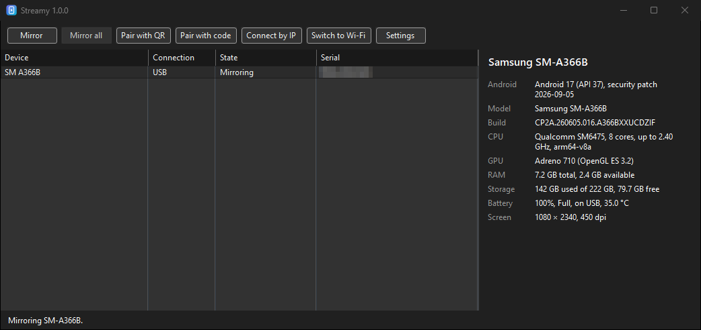
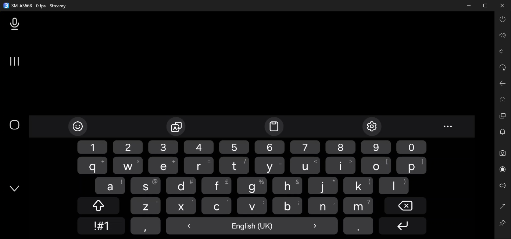

<div align="center">


# Streamy

**Your Android phone in a window on your PC. Watch it, hear it, control it, over USB or Wi-Fi.**

Streamy mirrors an Android phone's screen to Windows and lets you use it with your mouse and keyboard.
It plays the phone's sound on the PC, records to MP4, takes screenshots, installs APKs and sends files
by drag and drop, and shares the clipboard. Nothing is installed on the phone, and several phones can run
side by side, each in its own window.


[](LICENSE)


[**Download**](https://github.com/medovanx/streamy/releases/latest) | [Features](#features) | [Screenshots](#screenshots) | [Connect a phone](#connect-a-phone) | [Using the phone](#using-the-phone-from-the-pc) | [Privacy](#privacy) | [Build](#build-from-source)



</div>

---

## Features

- **Live screen.** The phone's screen in a window, decoded with FFmpeg and drawn with Direct3D 11, at the phone's own frame rate (about 100 fps from a 120 Hz phone in testing). The window takes the phone's shape, keeps its proportions when you resize it, turns when the phone turns, and goes fullscreen with F11.
- **Mouse and keyboard.** Click to tap, drag to swipe, Ctrl + drag to pinch, the wheel to scroll. Right click is Back, middle click is Home. Typing goes to the phone as text, in whatever layout the PC uses (Arabic, accents and emoji go through the phone's clipboard and are pasted), and shortcuts like Ctrl+A or Ctrl+C work.
- **Sound.** The phone's audio plays on the PC (Android 11+), kept in sync with the picture, with mute and volume.
- **Record and capture.** Record the screen and sound to MP4 without re-encoding, or save a full-resolution screenshot that is also copied to the clipboard.
- **Files and apps.** Drop APKs on a phone's window to install or update them; drop any other file to put it in the phone's Download folder, where Gallery and Files see it at once.
- **Clipboard.** Copy on the phone, paste on the PC. Ctrl+V in the window pastes the PC's clipboard on the phone.
- **Phone details.** Android version, model, build, CPU, GPU, RAM, storage, battery and screen of the selected phone, beside the device list.
- **Toolbar.** Power, volume, rotate, Back, Home, Recent apps, notifications, screenshot, record, mute, fullscreen and keep on top, beside each phone's screen.
- **Wi-Fi without cables.** Pair with a QR code or the six-digit code from Android's Wireless debugging, connect by address, or move a USB phone to Wi-Fi in one click. Wi-Fi phones are remembered and reconnect by themselves.
- **Several phones.** One window per phone, or open all of them with Mirror all.
- **Show touches.** A dot appears on the phone wherever it is touched, for demos and recordings. The phone's own setting comes back afterwards.
- **One exe.** adb, the scrcpy server and FFmpeg are built in. No Android SDK, no .NET install, no account. Updates itself from GitHub Releases (once the repository is public; see [Privacy](#privacy)).

## Screenshots

<table>
  <tr>
    <td align="center" colspan="2"><br><sub>A phone's window with its toolbar</sub></td>
  </tr>
  <tr>
    <td align="center"><br><sub>Settings</sub></td>
    <td align="center"><br><sub>Pair with a QR code</sub></td>
  </tr>
</table>

## Install

1. Download **`Streamy.exe`** from the [latest release](https://github.com/medovanx/streamy/releases/latest).
2. Put it somewhere permanent, for example `%LOCALAPPDATA%\Programs\Streamy\`, and run it.

The exe is self-contained, so you don't need to install .NET or the Android SDK. Windows SmartScreen may warn on first
run because the exe isn't code-signed yet: choose **More info**, then **Run anyway**. On first run Streamy unpacks adb,
the scrcpy server and FFmpeg to `%LOCALAPPDATA%\Streamy\bin`.

## Connect a phone

First, on the phone: **Settings > About phone** (on some phones **About phone > Software information**), tap **Build number**
seven times to unlock **Developer options**.

**Over USB**

1. In **Developer options**, turn on **USB debugging**.
2. Plug the phone in, unlock it and accept the **Allow USB debugging** prompt.
3. The phone appears as *Ready*. Double-click it.

**Over Wi-Fi, Android 11 and newer**

1. Put the PC and phone on the same network.
2. In **Developer options**, open **Wireless debugging** and turn it on.
3. In Streamy, click **Pair with QR**, then on the phone tap **Pair device with QR code** and scan it.
   Or tap **Pair device with pairing code** on the phone and use **Pair with code** in Streamy.
4. The phone appears as a Wi-Fi device. Double-click it.

**Over Wi-Fi, any Android version**

Plug the phone in with USB, select it and click **Switch to Wi-Fi**. Unplug it and keep mirroring.
Streamy remembers the phone and reconnects to it while it stays in Wi-Fi mode (until the phone restarts).

Some phones (Xiaomi, OPPO and others) block mouse and keyboard input from the PC until
**USB debugging (Security settings)** is turned on in Developer options.

## Using the phone from the PC

| On the PC | On the phone |
| --- | --- |
| Click, drag, hold | Tap, swipe, long press |
| Ctrl + drag | Pinch to zoom (two fingers, mirrored around the centre) |
| Wheel, tilt wheel | Scroll up and down, left and right |
| Right click | Back (wakes the screen if it is off) |
| Middle click | Home |
| Mouse side buttons | Recent apps, notifications |
| Typing | Text, in whatever layout the PC uses. Characters outside ASCII are pasted through the phone's clipboard, which they replace |
| Enter, Backspace, arrows, Esc, F1-F10, F12, Ctrl or Alt + key | The same keys |
| Ctrl+V, Shift+Insert | Paste the PC's clipboard |
| Copy on the phone | Lands in the PC's clipboard |
| Drop an APK on the window | Install or update it |
| Drop any other file | Copy it to Download |
| F11 | Fullscreen on and off |

Toolbar, top to bottom: Power (right-click turns only the phone's screen off and keeps mirroring), Volume up, Volume down,
Rotate, Back, Home, Recent apps, Notifications (right-click opens quick settings), Screenshot, Record, Mute, Fullscreen and
Keep on top (right-click keeps every phone's window on top).

Screenshots go to `Pictures\Streamy` and recordings to `Videos\Streamy`, or the folders you choose in Settings. If Windows'
Controlled Folder Access blocks those folders, Streamy saves to `%USERPROFILE%\Streamy` instead and says so.

## Settings

| Section | Options |
| --- | --- |
| Video | Resolution (the phone's own, or 2560 down to 800 px), bit rate, frame rate cap, codec (H.264, H.265, AV1) |
| Sound | Play the phone's sound on the PC, volume |
| Phone | Show touches, keep the phone awake while plugged in, turn its screen off when mirroring starts, lock it when the window closes |
| Windows and files | Keep phone windows on top, screenshot and recording folders |
| Updates | Check for updates at start, check now |

Video and phone options apply to phones mirrored after saving. Settings are stored in `%APPDATA%\Streamy\settings.json`
and errors are logged to `%LOCALAPPDATA%\Streamy\streamy.log`.

## Privacy

Streamy has no account, analytics or tracking. The screen, sound, clipboard and files go only between your phone and your
PC, over your own USB cable or local network.

| Service | When | What it sends |
| --- | --- | --- |
| [GitHub API](https://docs.github.com/rest/releases) | Update checks (turn them off in Settings) | Nothing besides the request |

While this repository is private, GitHub does not show its releases to running copies, so the update check finds nothing
and stays silent. Download new versions from the Releases page until the repository is public.

## How it works

- **The phone side** is [scrcpy-server](https://github.com/Genymobile/scrcpy) 5.0.1. Streamy pushes it to `/data/local/tmp`, starts it through `adb shell app_process` with a random session id, opens `adb forward tcp:0` to the session's abstract socket, connects the video, audio and control sockets, and removes the tunnel again. The server captures the screen with `MediaCodec` and the sound with `AudioRecord`, injects touch and key events, and leaves nothing behind when the session ends.
- **Streams.** The first socket carries the device name; each media stream starts with its codec id, then 12-byte headers carry the PTS, key frame and config flags, and the size. A session packet announces the frame size at start and after every rotation.
- **Video.** The codec configuration packet is put in front of the next frame and FFmpeg decodes it in low-delay mode. Frames go through a triple buffer to a render thread that uploads the Y, U and V planes as textures and converts them to RGB in a pixel shader with the stream's colour matrix (BT.601 or BT.709, limited or full range). A late frame is never queued: the newest one replaces it.
- **Audio.** Opus (or AAC, FLAC, raw) is decoded with FFmpeg and played through WASAPI with a 40 ms buffer. Whatever builds up past 200 ms is dropped, so sound never drifts behind the picture.
- **Recording.** The phone's packets are remuxed into MP4 as they arrive, without re-encoding. Recording asks the phone for a fresh key frame so the file starts at once, and carries new parameter sets after a rotation.
- **Control.** Mouse and keyboard events become scrcpy control messages in a platform-free mapper in `Streamy.Core/Input`. They go through a queue to one writer, so they reach the phone in order, and are serialized byte for byte like scrcpy's own client; the unit tests use scrcpy's test vectors.
- **Phone details** come from one `adb shell` call (`getprop`, `/proc/meminfo`, `df`, SurfaceFlinger's GLES line, `dumpsys battery`, `wm`, CPU frequencies), parsed in `Streamy.Core/Adb/DeviceInfo.cs`.
- **Updates** come from GitHub Releases tagged `vMAJOR.MINOR.PATCH`. The new exe is downloaded beside the running one and checked against the SHA-256 GitHub publishes, then swapped in and restarted.

## Project structure

```text
streamy/
├── src/
│   ├── Streamy.Core/             Logic with no Windows or UI dependencies
│   │   ├── Adb/                  adb output parsers, phone details, QR pairing
│   │   ├── Geometry/             Fitting the frame in the window, window to phone coordinates
│   │   ├── Input/                Android key codes, Windows key map, mouse/keyboard to control messages
│   │   ├── Protocol/             scrcpy control and device messages, packet headers, config merging
│   │   └── Server/               scrcpy-server options and start command
│   └── Streamy/                  The Windows app
│       ├── Assets/               App icon (drawn by UI/AppIcon.cs)
│       ├── Audio/                FFmpeg audio decoder, WASAPI player
│       ├── DevTools/             Command-line switches for testing against a real phone
│       ├── Recording/            MP4/MKV remuxer
│       ├── Services/             adb runner, bundled files, settings, file sending, updater, log
│       ├── Session/              One mirroring session: tunnel, sockets, stream readers, control queue
│       ├── ThirdParty/           adb, scrcpy-server, FFmpeg (downloaded, not committed)
│       ├── UI/                   Device list, details, phone window, toolbar, settings, pairing
│       └── Video/                FFmpeg video decoder, frame triple buffer, Direct3D 11 renderer
├── tests/
│   └── Streamy.Core.Tests/       xUnit tests
├── tools/
│   └── fetch-deps.ps1            Downloads and checks the pinned scrcpy release
├── docs/                         SRS, icon and screenshots
├── deps.json                     Pinned scrcpy version, URL and SHA-256
├── Directory.Build.props         Version and settings shared by every project
├── global.json                   Pinned .NET SDK
└── Streamy.slnx
```

## Build from source

Requirements: Windows 10 or 11 and the [.NET 11 SDK](https://dotnet.microsoft.com/download).

```bash
git clone https://github.com/medovanx/streamy.git
cd streamy
pwsh tools/fetch-deps.ps1
dotnet build
dotnet test
dotnet run --project src/Streamy -c Release
```

`fetch-deps.ps1` downloads the scrcpy release pinned in `deps.json`, checks its SHA-256 and copies adb, scrcpy-server
and the FFmpeg DLLs into `src/Streamy/ThirdParty`, where the build embeds them.

Build the single-file release exe:

```bash
dotnet publish src/Streamy/Streamy.csproj -c Release -r win-x64 --self-contained -p:PublishSingleFile=true -p:IncludeNativeLibrariesForSelfExtract=true -p:EnableCompressionInSingleFile=true -o publish
```

Developer switches:

| Switch | Purpose |
| --- | --- |
| `--mirror SERIAL` | Open the window for that phone at start |
| `--probe SERIAL OUT [SECONDS]` | Stream without a window, write the device name, codecs, frame size, packet, frame and audio counts to `OUT`, and save the newest frame as a PNG beside it |
| `--record SERIAL OUT.mp4 [SECONDS]` | Record without a window and report the file |
| `--send SERIAL OUT FILE...` | Send files and APKs the way a drop on the window does, and report the result |
| `--render-icon DIR` | Write `app.ico` and a 512 px `icon.png` |

### Updating scrcpy

The server refuses a client whose version differs from its own, so update both together: change the version, URL and
SHA-256 in `deps.json` (the digest is on the GitHub release page), set `ScrcpyProtocol.ServerVersion` to the same version,
check the [protocol notes](https://github.com/Genymobile/scrcpy/blob/master/doc/develop.md#protocol) for changes, then run
`fetch-deps.ps1`, the tests and a `--probe` against a real phone. If the new release ships FFmpeg with a new major version,
update the `FFmpeg.AutoGen` package to match.

## Releasing

Versions follow [Semantic Versioning](https://semver.org/). Bump `<Version>` in `Directory.Build.props`, add the changes
to [CHANGELOG.md](CHANGELOG.md), then tag and push:

```bash
git tag v1.0.1
git push origin v1.0.1
```

The [release workflow](.github/workflows/release.yml) checks that the tag matches the version, runs the tests, builds
`Streamy.exe` and publishes a GitHub Release with the changelog entry as its notes, which running copies pick up.

## Credits

- [scrcpy](https://github.com/Genymobile/scrcpy) by Genymobile and Romain Vimont (Apache-2.0): the phone-side server and the protocol.
- [Android SDK Platform-Tools](https://developer.android.com/tools/releases/platform-tools) (Apache-2.0): adb.
- [FFmpeg](https://ffmpeg.org/) (LGPL-2.1+): video and audio decoding and MP4 muxing, through [FFmpeg.AutoGen](https://github.com/Ruslan-B/FFmpeg.AutoGen) (MIT).
- [Vortice.Windows](https://github.com/amerkoleci/Vortice.Windows) (MIT): Direct3D 11 bindings.
- [NAudio](https://github.com/naudio/NAudio) (MIT): WASAPI playback.
- [QRCoder](https://github.com/codebude/QRCoder) (MIT): the pairing QR code.
- Icons: Segoe Fluent Icons by Microsoft, built into Windows.

## License

[MIT](LICENSE). Bundled third-party files keep their own licenses; see [THIRD-PARTY-NOTICES.md](THIRD-PARTY-NOTICES.md).
