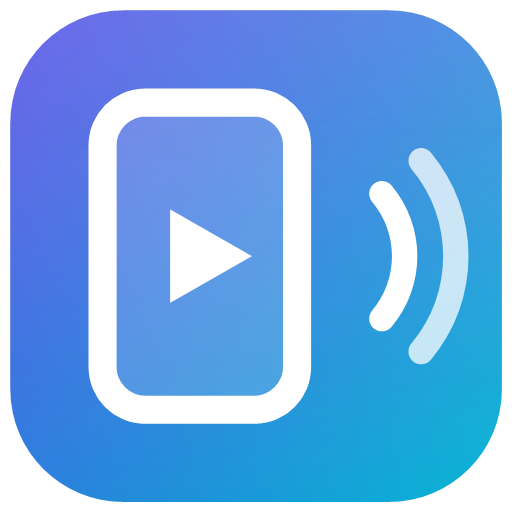
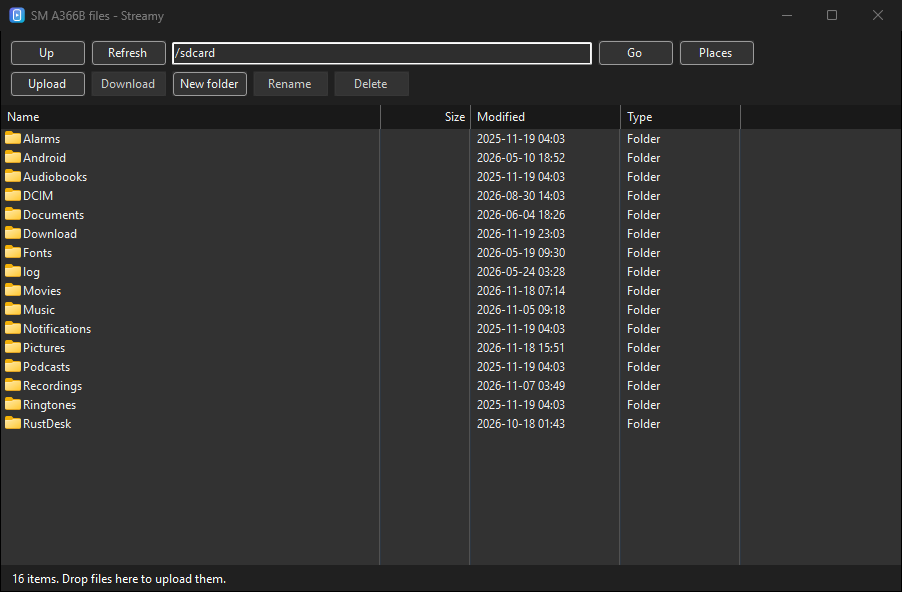
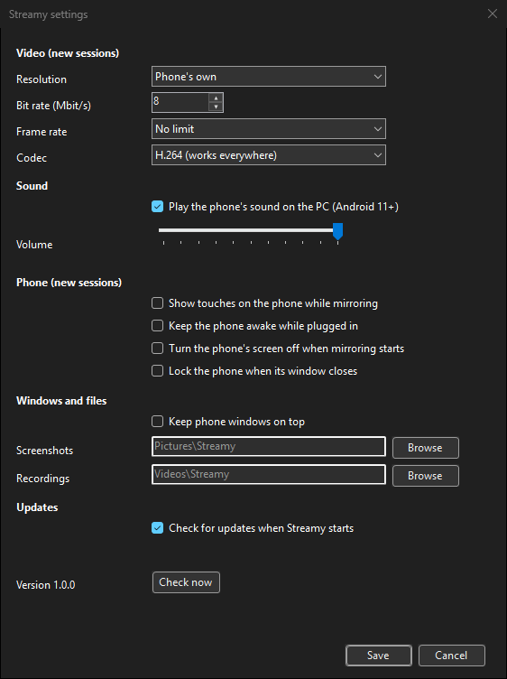
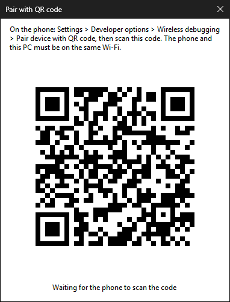

<div align="center">



# Streamy

**Your Android phone in a window on your PC. Watch it, hear it, control it, over USB or Wi-Fi.**

Streamy mirrors an Android phone's screen to Windows and lets you use it with your mouse and keyboard.
It plays the phone's sound on the PC, records to MP4, takes screenshots, shows the phone's photos and videos by album,
browses and manages the phone's files,
installs APKs by drag and drop, and shares the clipboard. Nothing is installed on the phone, and several phones can run
side by side, each in its own window.

[](https://github.com/medovanx/streamy/releases/latest)
[](https://github.com/medovanx/streamy/actions/workflows/ci.yml)
[](https://github.com/medovanx/streamy/releases)
[](LICENSE)


[**Download**](https://github.com/medovanx/streamy/releases/latest) | [Features](#features) | [Screenshots](#screenshots) | [Connect a phone](#connect-a-phone) | [Using the phone](#using-the-phone-from-the-pc) | [Privacy](#privacy) | [Build](#build-from-source)


</div>

---

## Features

- **Live screen.** The phone's screen in a window, decoded with FFmpeg and drawn with Direct3D 11, at the phone's own frame rate (about 100 fps from a 120 Hz phone in testing). The window takes the phone's shape, keeps its proportions when you resize it, turns when the phone turns, and goes fullscreen with F11.
- **Mouse and keyboard.** Click to tap, drag to swipe, Ctrl + drag to pinch, the wheel to scroll. Right click is Back, middle click is Home. Typing goes to the phone as text, in whatever layout the PC uses (Arabic, accents and emoji go through the phone's clipboard and are pasted), and shortcuts like Ctrl+A or Ctrl+C work.
- **Sound.** The phone's audio plays on the PC (Android 11+), kept in sync with the picture, with mute and volume.
- **Record and capture.** Record the screen and sound to MP4 without re-encoding, or save a full-resolution screenshot that is also copied to the clipboard.
- **Gallery.** The phone's photos and videos by album and by place, as a thumbnail grid (HEIC and videos included). Drag across thumbnails to select several. A side panel shows each item's details: date, size, resolution, camera settings, where it was taken. Download, upload or delete, or drag photos straight out to Explorer.
- **Gallery backup.** One click copies every photo and video to a PC folder, keeping the phone's folders and dates. The next backup copies only what is new.
- **Map.** Where your photos were taken, as pins with the newest photo on an OpenStreetMap map. Click a pin to see its photos (opt-in: the map tiles come from OpenStreetMap).
- **Built-in viewer.** Open a photo or video and swipe through the album like on the phone: drag sideways, scroll the wheel or press the arrow keys. Videos play right there, with play/pause, a seek bar and mute.
- **File manager.** Browse the phone's storage, download files and folders to the PC, upload by button or by dropping them from Explorer, create folders, rename and delete. Double-click a file to open it on the PC.
- **Apps.** Every app with its icon, version and size. Open one on the phone, or in **its own window on the PC** on a separate display, so the phone's screen stays free. Force stop, clear data, uninstall, or back up the APK.
- **Files and apps.** Drop APKs on a phone's window to install or update them; drop any other file to put it in the phone's Download folder, where Gallery and Files see it at once.
- **Notifications on the PC.** The phone's new notifications show as Windows notifications; click one to open the phone's window (opt-in, in Settings).
- **Log and shell.** The phone's logcat as it happens, with level and text filters, and a shell that keeps its folder between commands.
- **Clipboard.** Copy on the phone, paste on the PC. Ctrl+V in the window pastes the PC's clipboard on the phone.
- **Phone details.** Android version, model, build, CPU, GPU, RAM, storage, battery and screen of the selected phone, beside the device list. Each phone's window shows its battery and temperature in the title.
- **Toolbar.** Power, volume, rotate, Back, Home, Recent apps, notifications, gallery, files, screenshot, record, mute, fullscreen and keep on top, beside each phone's screen.
- **Wi-Fi without cables.** Pair with a QR code or the six-digit code from Android's Wireless debugging, connect by address, or move a USB phone to Wi-Fi in one click. Wi-Fi phones are remembered and reconnect by themselves.
- **Reconnects by itself.** When Wi-Fi drops or the cable comes out, the phone's window stays and its session comes back as soon as the phone does.
- **Several phones.** One window per phone, or open all of them with Mirror all.
- **Show touches.** A dot appears on the phone wherever it is touched, for demos and recordings. The phone's own setting comes back afterwards.
- **One exe.** adb, the scrcpy server and FFmpeg are built in. No Android SDK, no .NET install, no account. Updates itself from GitHub Releases, with a progress bar.

## Screenshots

<table>
  <tr>
    <td align="center" colspan="2"><br><sub>A phone's window with its toolbar</sub></td>
  </tr>
  <tr>
    <td align="center" colspan="2"><br><sub>File manager</sub></td>
  </tr>
  <tr>
    <td align="center"><br><sub>Settings</sub></td>
    <td align="center"><br><sub>Pair with a QR code</sub></td>
  </tr>
</table>

## Install

1. Download **`Streamy.exe`** from the [latest release](https://github.com/medovanx/streamy/releases/latest).
2. Put it somewhere permanent, for example `%LOCALAPPDATA%\Programs\Streamy\`, and run it.

The exe is self-contained, so you don't need to install .NET or the Android SDK. Windows SmartScreen may warn on first
run because the exe isn't code-signed yet: choose **More info**, then **Run anyway**. On first run Streamy unpacks adb,
the scrcpy server and FFmpeg to `%LOCALAPPDATA%\Streamy\bin`.

## Connect a phone

First, on the phone: **Settings > About phone** (on some phones **About phone > Software information**), tap **Build number**
seven times to unlock **Developer options**.

**Over USB**

1. In **Developer options**, turn on **USB debugging**.
2. Plug the phone in, unlock it and accept the **Allow USB debugging** prompt.
3. The phone appears as *Ready*. Double-click it.

**Over Wi-Fi, Android 11 and newer**

1. Put the PC and phone on the same network.
2. In **Developer options**, open **Wireless debugging** and turn it on.
3. In Streamy, click **Pair with QR**, then on the phone tap **Pair device with QR code** and scan it.
   Or tap **Pair device with pairing code** on the phone and use **Pair with code** in Streamy.
4. The phone appears as a Wi-Fi device. Double-click it.

**Over Wi-Fi, any Android version**

Plug the phone in with USB, select it and click **Switch to Wi-Fi**. Unplug it and keep mirroring.
Streamy remembers the phone and reconnects to it while it stays in Wi-Fi mode (until the phone restarts).

Some phones (Xiaomi, OPPO and others) block mouse and keyboard input from the PC until
**USB debugging (Security settings)** is turned on in Developer options.

## Using the phone from the PC

| On the PC | On the phone |
| --- | --- |
| Click, drag, hold | Tap, swipe, long press |
| Ctrl + drag | Pinch to zoom (two fingers, mirrored around the centre) |
| Wheel, tilt wheel | Scroll up and down, left and right |
| Right click | Back (wakes the screen if it is off) |
| Middle click | Home |
| Mouse side buttons | Recent apps, notifications |
| Typing | Text, in whatever layout the PC uses. Characters outside ASCII are pasted through the phone's clipboard, which they replace |
| Enter, Backspace, arrows, Esc, F1-F10, F12, Ctrl or Alt + key | The same keys |
| Ctrl+V, Shift+Insert | Paste the PC's clipboard |
| Copy on the phone | Lands in the PC's clipboard |
| Drop an APK on the window | Install or update it |
| Drop any other file | Copy it to Download |
| F11 | Fullscreen on and off |

Toolbar, top to bottom: Power (right-click turns only the phone's screen off and keeps mirroring), Volume up, Volume down,
Rotate, Back, Home, Recent apps, Notifications (right-click opens quick settings), Files, Gallery, Apps, Log and shell, Screenshot,
Record, Mute, Fullscreen and Keep on top (right-click keeps every phone's window on top).

The title shows the frame rate and the phone's battery and temperature, refreshed every 30 seconds. If the connection
drops, the title says so and the window keeps the last picture; when the phone is back (up to two minutes later), a new
session opens in its place. Turn this off in Settings.

## Apps

Open it with **Apps** in the main window, on a phone's right-click menu, or from its toolbar. It lists the apps with a home
screen icon (or all installed apps, or system apps too), with their icons, version, size and last update. Type to search.

| Action | How |
| --- | --- |
| Open on the phone | Double-click, Enter or **Open** |
| Open in its own window | **Open in window**: the app starts on a separate display that only Streamy shows, so the phone's own screen stays free. Closing the window closes the app |
| Force stop | **Force stop** |
| Clear data | **Clear data**, after a confirmation |
| Uninstall | **Uninstall**, after a confirmation (apps that came with the phone cannot be) |
| Back up the APK | **Back up APK**: one `.apk`, or a folder of them for apps split into several |

Android does not let adb read app names, icons or sizes, so Streamy brings a small helper (`helper/`, 5 KB) that runs on
the phone the same way the scrcpy server does, prints them and exits. Icons are kept in `%LOCALAPPDATA%\Streamy\icons`.

## Gallery

Open it with **Gallery** in the main window, on a phone's right-click menu, or from its toolbar. Albums are on the left
(all photos and videos, videos only, the phone's albums by size, then **Places**), thumbnails in the middle, newest first,
and the details of the selection on the right.

| Action | How |
| --- | --- |
| Select | Click; drag across thumbnails for several (Ctrl+drag adds); Ctrl+click, Shift+click, Ctrl+A, arrows |
| View | Double-click, Enter or **View** opens the built-in viewer |
| Open in another app | Right-click, **Open in app** |
| Filter by place | Pick a place under **Places** |
| Download | Select, **Download**, pick a folder |
| Upload | **Upload** puts photos and videos into the open album's folder (`Pictures/Streamy` for the first two) and the phone indexes them at once |
| Drag to Explorer | Drag a selected photo out of the window (the whole selection comes along) and drop it in a folder, on the desktop or in another app. Dragging from an unselected photo draws the selection box instead |
| Delete | **Delete** or the Delete key, after a confirmation. Deleted items do not go to the phone's trash |
| Back up | **Back up** copies every photo and video to a folder (`Pictures\Streamy backup\PHONE` unless you pick another; right-click the button to change it). The phone's folders are kept (`DCIM\Camera`, `Pictures\Screenshots`) with the original dates, and later backups copy only what is new |
| Map | **Map** shows the photos and videos with a location on a map; click a pin to see them in the gallery |

**Details panel:** date taken and added, album, type, size, resolution in megapixels, camera settings (aperture, shutter,
ISO), rotation, the app that made it, favourite, the place and its coordinates with **Show on map**, and the path on the
phone. With several selected: counts, total size, date range and the places they were taken.

**Viewer:** swipe by dragging the picture sideways (or a video), the mouse wheel, the arrow keys, Page Up/Down, Home/End
or the buttons. The phone's thumbnail shows at once and the full picture replaces it when it arrives (HEIC needs Windows'
HEIF extension for full size); the next and previous photos are prepared in the background. Videos play inside the
viewer with play/pause (or Space, or a click), a seek bar and mute. F11 or double-click is fullscreen, Esc leaves it or
closes. Full-size copies are kept in `%LOCALAPPDATA%\Streamy\media` (up to 2 GB).

**Places:** where each photo and video was taken is read from a small part of the file (EXIF GPS, or the location tag
camera videos write) in the background the first time the gallery opens; this takes about a minute for 8,000 items
over USB and is remembered afterwards. Coordinates are named offline with the [GeoNames](https://www.geonames.org)
city list built into Streamy.

**Map:** the first time, Streamy explains that the map is drawn with tiles from OpenStreetMap and asks before loading
any. Tiles are kept in `%LOCALAPPDATA%\Streamy\tiles`. Nearby photos share a pin showing the newest one and a count; drag
to move, scroll or double-click to zoom, Home to see everything again.

Thumbnails are made by the phone, about one per second each, eight at a time, visible ones first. Each is kept in
`%LOCALAPPDATA%\Streamy\thumbs`, so an album opens straight away the next time.

## File manager

Open it with **Files** in the main window, **Browse files** when you right-click a phone, or the folder button on a phone's
toolbar. It starts in the phone's internal storage (`/sdcard`); **Places** jumps to Download, Camera, Screenshots, Pictures,
Movies, Music and Documents, and you can type any path.

| Action | How |
| --- | --- |
| Open a folder | Double-click it, or type its path and press Enter |
| Go up | **Up** or Backspace |
| Open a file on the PC | Double-click it (it is copied to a temporary folder first) |
| Download to the PC | Select files or folders, **Download**, pick a folder |
| Upload to the phone | **Upload**, or drop files and folders from Explorer onto the list |
| New folder | **New folder** |
| Rename | **Rename** or F2; an existing name is never overwritten |
| Delete | **Delete** or the Delete key, after a confirmation |
| Refresh | **Refresh** or F5 |

Everything goes over adb, so it works over USB and Wi-Fi. Android only lets adb into shared storage and a few system
folders; private app data (`/data`) says "Permission denied".

Screenshots go to `Pictures\Streamy` and recordings to `Videos\Streamy`, or the folders you choose in Settings. If Windows'
Controlled Folder Access blocks those folders, Streamy saves to `%USERPROFILE%\Streamy` instead and says so.

## Notifications, log and shell

**Notifications:** turn on "Show the phone's notifications on this PC" in Settings. A Streamy icon appears in the
notification area and new notifications from the phone show as Windows notifications with the app's name; clicking one
opens that phone's window. Running services and media players are left out. Streamy reads them with
`dumpsys notification` in a loop on the phone every five seconds; nothing is installed and nothing leaves your PC.

**Log and shell** (right-click a phone, or the toolbar's terminal button): the Log tab streams `logcat` with the last
5,000 lines, coloured by level, with a level and text filter (tag, message or process id), pause, copy and save. The
Shell tab runs commands on the phone in one shell, so `cd` and variables carry over; Up and Down recall earlier commands.

## Settings

| Section | Options |
| --- | --- |
| Video | Resolution (the phone's own, or 2560 down to 800 px), bit rate, frame rate cap, codec (H.264, H.265, AV1) |
| Sound | Play the phone's sound on the PC, volume |
| Phone | Show touches, keep the phone awake while plugged in, turn its screen off when mirroring starts, lock it when the window closes, reconnect by itself, show the phone's notifications on this PC |
| Windows and files | Keep phone windows on top, screenshot and recording folders |
| Updates | Check for updates at start, check now |

Video and phone options apply to phones mirrored after saving. Settings are stored in `%APPDATA%\Streamy\settings.json`
and errors are logged to `%LOCALAPPDATA%\Streamy\streamy.log`.

## Privacy

Streamy has no account, analytics or tracking. The screen, sound, clipboard and files go only between your phone and your
PC, over your own USB cable or local network.

| Service | When | What it sends |
| --- | --- | --- |
| [GitHub API](https://docs.github.com/rest/releases) | Update checks (turn them off in Settings) | Nothing besides the request |
| [OpenStreetMap](https://www.openstreetmap.org) | Only when you click **Show on map** in the gallery | The photo's coordinates, in the map address |
| [OpenStreetMap tiles](https://operations.osmfoundation.org/policies/tiles/) | Only in the gallery's **Map**, after you agree | Requests for the map tiles on screen, which shows the areas you look at |

Place names in the gallery are worked out on your PC from a built-in city list; no location is looked up online.

## How it works

- **The phone side** is [scrcpy-server](https://github.com/Genymobile/scrcpy) 5.0.1. Streamy pushes it to `/data/local/tmp`, starts it through `adb shell app_process` with a random session id, opens `adb forward tcp:0` to the session's abstract socket, connects the video, audio and control sockets, and removes the tunnel again. The server captures the screen with `MediaCodec` and the sound with `AudioRecord`, injects touch and key events, and leaves nothing behind when the session ends.
- **Streams.** The first socket carries the device name; each media stream starts with its codec id, then 12-byte headers carry the PTS, key frame and config flags, and the size. A session packet announces the frame size at start and after every rotation.
- **Video.** The codec configuration packet is put in front of the next frame and FFmpeg decodes it in low-delay mode. Frames go through a triple buffer to a render thread that uploads the Y, U and V planes as textures and converts them to RGB in a pixel shader with the stream's colour matrix (BT.601 or BT.709, limited or full range). A late frame is never queued: the newest one replaces it.
- **Audio.** Opus (or AAC, FLAC, raw) is decoded with FFmpeg and played through WASAPI with a 40 ms buffer. Whatever builds up past 200 ms is dropped, so sound never drifts behind the picture.
- **Recording.** The phone's packets are remuxed into MP4 as they arrive, without re-encoding. Recording asks the phone for a fresh key frame so the file starts at once, and carries new parameter sets after a rotation.
- **Control.** Mouse and keyboard events become scrcpy control messages in a platform-free mapper in `Streamy.Core/Input`. They go through a queue to one writer, so they reach the phone in order, and are serialized byte for byte like scrcpy's own client; the unit tests use scrcpy's test vectors.
- **Apps** come from `helper/`, a few hundred lines of Java built to a 5 KB dex (`tools/build-helper.ps1`) and run with `app_process` like scrcpy-server. As the shell user it asks the package manager for labels, versions and icons, and the storage-stats service for sizes. **App windows** use scrcpy's virtual display option: the app starts on a new display that is mirrored, while the phone's own screen is untouched.
- **Phone details** come from one `adb shell` call (`getprop`, `/proc/meminfo`, `df`, SurfaceFlinger's GLES line, `dumpsys battery`, `wm`, CPU frequencies), parsed in `Streamy.Core/Adb/DeviceInfo.cs`.
- **Updates** come from GitHub Releases tagged `vMAJOR.MINOR.PATCH`. The new exe is downloaded beside the running one with a progress window (size, percent, speed, Cancel), checked against the SHA-256 GitHub publishes, then swapped in and restarted.

## Project structure

```text
streamy/
├── src/
│   ├── Streamy.Core/             Logic with no Windows or UI dependencies
│   │   ├── Adb/                  adb output parsers, phone details, QR pairing, notifications, logcat lines
│   │   ├── Apps/                 Installed apps from the phone helper, app commands
│   │   ├── Files/                Phone folder listing, paths and shell quoting
│   │   ├── Media/                Phone media library, details, GPS, offline place names, backup plan, map maths
│   │   ├── Geometry/             Fitting the frame in the window, window to phone coordinates
│   │   ├── Input/                Android key codes, Windows key map, mouse/keyboard to control messages
│   │   ├── Protocol/             scrcpy control and device messages, packet headers, config merging
│   │   └── Server/               scrcpy-server options and start command
│   └── Streamy/                  The Windows app
│       ├── Assets/               App icon (drawn by UI/AppIcon.cs) and the built phone helper
│       ├── Audio/                FFmpeg audio decoder, WASAPI player
│       ├── DevTools/             Command-line switches for testing against a real phone
│       ├── Recording/            MP4/MKV remuxer
│       ├── Services/             adb runner, bundled files, settings, file sending, updater, log
│       ├── Session/              One mirroring session: tunnel, sockets, stream readers, control queue
│       ├── ThirdParty/           adb, scrcpy-server, FFmpeg (downloaded, not committed)
│       ├── UI/                   Device list, phone window, gallery, viewer, map, apps, files, log and shell, settings
│       └── Video/                FFmpeg video decoder, frame triple buffer, Direct3D 11 renderer
├── helper/src/                   The phone-side helper (Java, runs with app_process)
├── tests/
│   └── Streamy.Core.Tests/       xUnit tests
├── tools/
│   ├── fetch-deps.ps1            Downloads and checks the pinned scrcpy release
│   └── build-helper.ps1          Builds the helper with the Android SDK (the result is committed)
├── docs/                         SRS, icon and screenshots
├── deps.json                     Pinned scrcpy version, URL and SHA-256
├── Directory.Build.props         Version and settings shared by every project
├── global.json                   Pinned .NET SDK
└── Streamy.slnx
```

## Build from source

Requirements: Windows 10 or 11 and the [.NET 11 SDK](https://dotnet.microsoft.com/download).

```bash
git clone https://github.com/medovanx/streamy.git
cd streamy
pwsh tools/fetch-deps.ps1
dotnet build
dotnet test
dotnet run --project src/Streamy -c Release
```

`fetch-deps.ps1` downloads the scrcpy release pinned in `deps.json`, checks its SHA-256 and copies adb, scrcpy-server
and the FFmpeg DLLs into `src/Streamy/ThirdParty`, where the build embeds them.

Build the single-file release exe:

```bash
dotnet publish src/Streamy/Streamy.csproj -c Release -r win-x64 --self-contained -p:PublishSingleFile=true -p:IncludeNativeLibrariesForSelfExtract=true -p:EnableCompressionInSingleFile=true -o publish
```

Developer switches:

| Switch | Purpose |
| --- | --- |
| `--mirror SERIAL` | Open the window for that phone at start |
| `--probe SERIAL OUT [SECONDS]` | Stream without a window, write the device name, codecs, frame size, packet, frame and audio counts to `OUT`, and save the newest frame as a PNG beside it |
| `--record SERIAL OUT.mp4 [SECONDS]` | Record without a window and report the file |
| `--send SERIAL OUT FILE...` | Send files and APKs the way a drop on the window does, and report the result |
| `--files SERIAL OUT` | Run every file manager operation in a throwaway folder on the phone and report each one |
| `--gallery SERIAL OUT` | Read the media library, then upload, find, thumbnail, download and delete a generated test picture |
| `--viewer-test SERIAL OUT` | Copy and decode the newest HEIC and JPEG and a short video, and report timings |
| `--places SERIAL OUT` | Read every item's location and report how many have one and how long it took |
| `--apps SERIAL OUT` | List apps, fetch their icons and sizes, and open the calculator on a virtual display |
| `--backup-test SERIAL OUT` | Back up the 12 newest items to a temporary folder twice and check the second run copies only a damaged file |
| `--drag-test SERIAL OUT` | Drop two photos on a temporary folder through Explorer's own drop target |
| `--notify-test SERIAL OUT` | Post a test notification from the shell and check the watcher reports it once |
| `--console-test SERIAL OUT` | Open the log and shell window and check both work |
| `--map-test OUT.png` | Draw the map with made-up pins |
| `--render-icon DIR` | Write `app.ico` and a 512 px `icon.png` |

### Updating scrcpy

The server refuses a client whose version differs from its own, so update both together: change the version, URL and
SHA-256 in `deps.json` (the digest is on the GitHub release page), set `ScrcpyProtocol.ServerVersion` to the same version,
check the [protocol notes](https://github.com/Genymobile/scrcpy/blob/master/doc/develop.md#protocol) for changes, then run
`fetch-deps.ps1`, the tests and a `--probe` against a real phone. If the new release ships FFmpeg with a new major version,
update the `FFmpeg.AutoGen` package to match.

## Releasing

Versions follow [Semantic Versioning](https://semver.org/). Bump `<Version>` in `Directory.Build.props`, add the changes
to [CHANGELOG.md](CHANGELOG.md), then tag and push:

```bash
git tag v1.5.1
git push origin v1.5.1
```

The [release workflow](.github/workflows/release.yml) checks that the tag matches the version, runs the tests, builds
`Streamy.exe` and publishes a GitHub Release with the changelog entry as its notes, which running copies pick up.

## Credits

- [scrcpy](https://github.com/Genymobile/scrcpy) by Genymobile and Romain Vimont (Apache-2.0): the phone-side server and the protocol.
- [Android SDK Platform-Tools](https://developer.android.com/tools/releases/platform-tools) (Apache-2.0): adb.
- [FFmpeg](https://ffmpeg.org/) (LGPL-2.1+): video and audio decoding and MP4 muxing, through [FFmpeg.AutoGen](https://github.com/Ruslan-B/FFmpeg.AutoGen) (MIT).
- [Vortice.Windows](https://github.com/amerkoleci/Vortice.Windows) (MIT): Direct3D 11 bindings.
- [NAudio](https://github.com/naudio/NAudio) (MIT): WASAPI playback.
- [QRCoder](https://github.com/codebude/QRCoder) (MIT): the pairing QR code.
- [GeoNames](https://www.geonames.org) (CC BY 4.0): the city and country lists used to name places.
- [OpenStreetMap](https://www.openstreetmap.org/copyright) (ODbL, © OpenStreetMap contributors): the map tiles in the gallery's map.
- Icons: Segoe Fluent Icons by Microsoft, built into Windows.

## License

[MIT](LICENSE). Bundled third-party files keep their own licenses; see [THIRD-PARTY-NOTICES.md](THIRD-PARTY-NOTICES.md).
